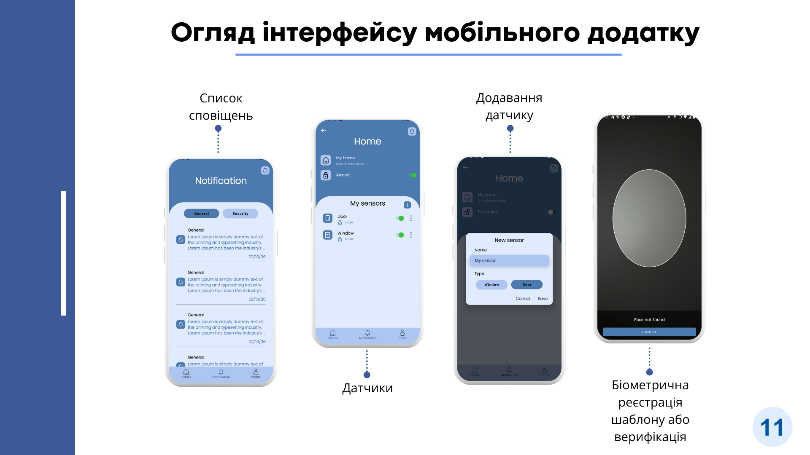

# Safe Home — Mobile App

The basic version of a smart home security system.

An Android application for managing homes, sensors, and security modes, with real-time notifications.

## Main Features

- Authentication (email/password + Google Sign-In)
- Home management (adding, editing, archiving, and deleting)
- Sensor management (adding, viewing status, arming/disarming)
- Notifications (general and security-related) via Firebase Cloud Messaging
- User profile and settings

## Technologies

- Kotlin
- MVVM
- Retrofit
- Firebase Cloud Messaging
- EncryptedSharedPreferences
- Navigation Component
- Material Design

## Screenshots

## Author

Vladyslav Bilous  
Kharkiv National University of Radio Electronics  
Specialty 121 — Software Engineering
